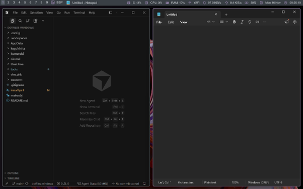

# Lightweight Windows bootstrap

This repository sets up a Windows workstation with **small, fast programs** instead of
the default Microsoft apps and heavier suites. The installer prefers native binaries
and portable tools: a Rust tiling window manager, a Rust terminal, a Vim layer, and
focused replacements for search, screenshots, photos, and media.

It is not a Workspacer, PowerToys, or Flow Launcher setup. Those programs, along with
YASB, Brave, WinShotX, Windows Terminal, Photos, and Snipping Tool, are removed when
present.



## Current programs

| Role | Program |
| --- | --- |
| Tiling window manager and bar | [komorebi](https://github.com/LGUG2Z/komorebi) + `whkd` |
| Vim keys outside the terminal | [Windows-Automation](https://github.com/eqan/Windows-Automation) (`vim_ahk`) |
| Terminal | [WezTerm](https://wezfurlong.org/wezterm/) + PowerShell 7 |
| Editor | Neovim |
| Spotlight-style search | [Keypirinha](https://keypirinha.com/) + [Everything](https://www.voidtools.com/) |
| Clipboard history | Ditto |
| Screenshots | Flameshot |
| Image viewer | [ImageGlass](https://imageglass.org/) (WinUI3 Dark, Mica) |
| Browser | Zen Browser |
| Media / archives / PDF text | VLC, 7-Zip, MuPDF (`mutool`) |
| File manager | `lf` (ranger-style), with Yazi available |
| Unix-style CLI | Microsoft Coreutils, eza, zoxide, ripgrep, fd, fzf, bat, jq, Git, GitHub CLI |
| Font | JetBrainsMono Nerd Font |

The PowerShell profile uses PSReadLine's native Vi prompt. It does not load oh-my-posh,
`posh-git`, or Terminal-Icons at startup.

## Replaced software

The bootstrap uninstalls leftovers and switches the workflow to the programs above:

| Removed | Replacement |
| --- | --- |
| Workspacer | komorebi |
| YASB | komorebi built-in bar |
| PowerToys | Keypirinha, Everything, Flameshot, komorebi, Vim AHK |
| Flow Launcher | Keypirinha |
| Windows Photos | ImageGlass |
| Snipping Tool | Flameshot |
| Windows Terminal | WezTerm |
| WinShotX | Flameshot |
| Brave | Zen Browser |

## One-command installation

Open **Administrator PowerShell** in this repository and run:

```powershell
powershell.exe -NoProfile -ExecutionPolicy Bypass -File ".\install.ps1"
```

The installer also:

- Optionally applies battery C-state-friendly power settings at the start
- Optionally runs Chris Titus Tech WinUtil **Minimal** debloat when `$windowsAlreadyDebloated` is `$false`
- Applies WinUtil-style Security Windows Update policy (feature updates deferred, drivers off, notify before install)
- Auto-hides the Windows taskbar so only komorebi-bar stays visible
- Hides desktop icons by default (`Ctrl+Alt+D` in Vim AHK toggles them)
- Registers komorebi and Vim AHK as elevated logon tasks
- Starts Everything and Ditto hidden in the tray
- Registers ImageGlass as the default photo viewer

## Desktop controls

komorebi uses `Alt` as its modifier: `Alt+H/J/K/L` moves focus, `Alt+Shift+H/L`
shrinks/expands the primary column, `Alt+Shift+J/K` adjusts vertical sizing,
`Alt+1..9` switches workspaces, and `Alt+Space` cycles layouts. Window movement
uses `Ctrl+Alt+H/J/K/L` so it does not conflict with resizing.
`Alt+C` and `Alt+Q` close the focused window.

If hotkeys become unresponsive, press `Win+O` or run
`powershell -File .\komorebi\restart-komorebi.ps1`.

Manual start:

```powershell
& "C:\Program Files\komorebi\bin\komorebic.exe" start
```

## Search, screenshots, and files

- **Keypirinha** is `Ctrl+Alt+S`; Vim AHK forwards `Win+S` to it. File search uses the
  already-running Everything index.
- **Flameshot** is `Win+Shift+S` region capture to the clipboard. The installer
  republishes the image so Ditto records it. Flameshot starts at logon.
- **ImageGlass** opens images from Explorer and `lf`, with the WinUI3 Dark theme.
- **`lf`** uses a ranger-style dark theme: Neovim for text, ImageGlass for images,
  VLC for media.

PowerShell aliases: `vim-ahk` enters the Windows-Automation checkout, `dotfiles`
enters this repository. Tab accepts an inline history suggestion, or opens completion
when none exists. Vim AHK is disabled inside WezTerm.

Windows still protects some file associations. If a type stays bound to another app,
set ImageGlass, VLC, Zen Browser, and your PDF handler in
**Settings → Apps → Default apps**.

## Debloating and battery

WinUtil Minimal runs only when `$windowsAlreadyDebloated` in `install.ps1` is `$false`.
It is currently `$true` on this machine. See the
[Chris Titus Tech Windows Utility](https://christitus.com/windows-tool).

The optional battery prompt enables processor idle, core parking, a 5% minimum
processor state on battery, and maximum PCIe ASPM. Firmware still decides the actual
C-state.

## Vim AHK

The installer clones and builds [Windows-Automation](https://github.com/eqan/Windows-Automation).
`Win+X` launches elevated WezTerm. Zen Browser is excluded from Vim AHK; Normal mode
blocks ordinary text input while preserving Vim bindings.

After changing the source:

```powershell
. $PROFILE
vim-refresh
```

Use `vim-refresh -NoPull` to rebuild without pulling from GitHub.
